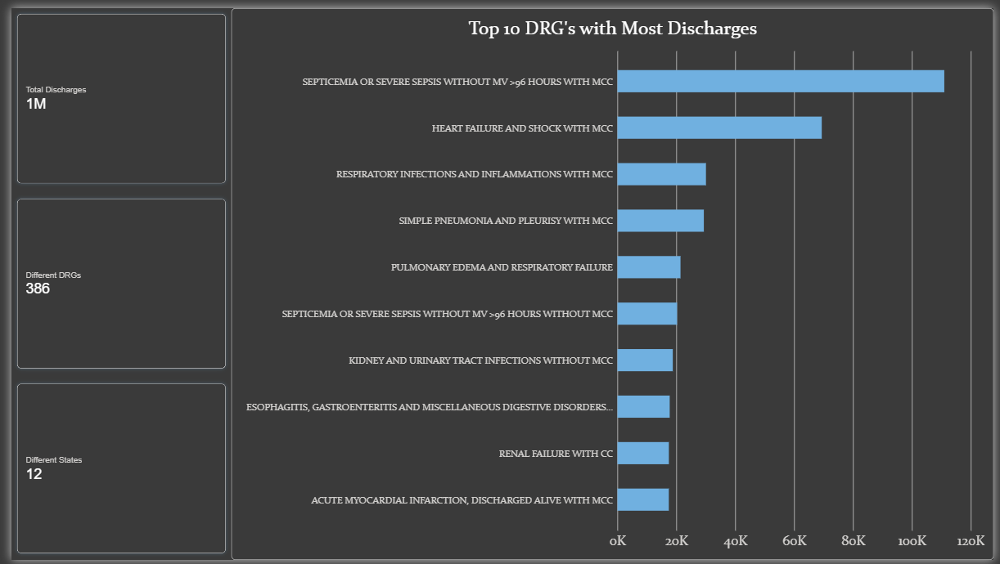
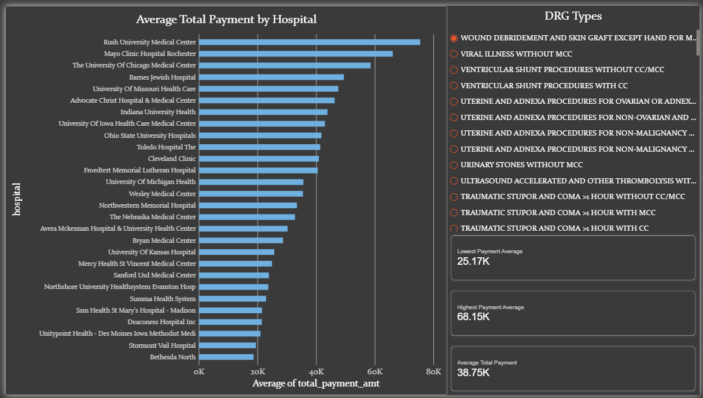
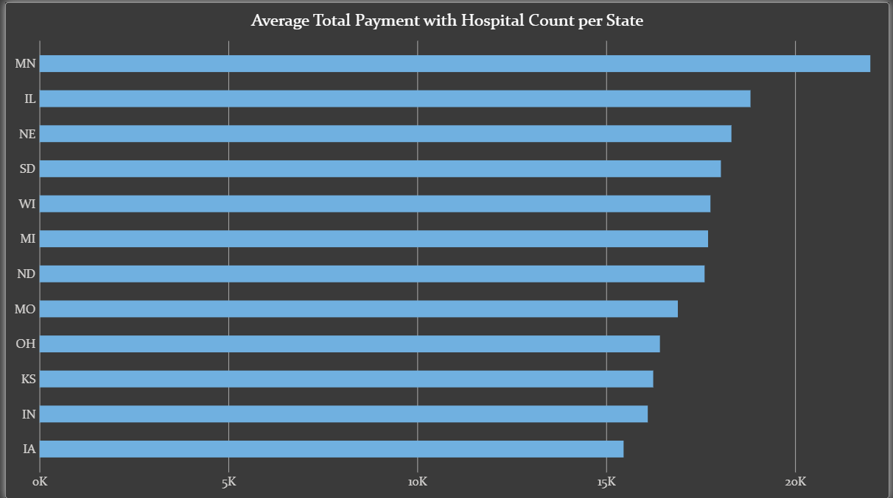

# CMS Medicare Inpatient Hospitals - by Provider and Service

---

# Anthony Vudis

---

# 11/12/26

---

# Description

I would like to work with real applicable data and see what I am capable of doing and I am using the dataset by CMS to practice. I am going to use Pandas for data sorting and cleaning, DuckDB SQL for answering important questions on the data, then I will use Power BI for visualizations. I will narrow down my focus to just the Midwest (states such as IL, IN, IA, KS, MI, MN, MO, NE, ND, OH, SD, WI). I plan to compare the data over 10 years to see how prices and coverage have changed. V1 will start with just a single year(2024), V2 will be incremented years such as every 2 years from 2014 to 2024, and V3 will be all 10 years from 2014 to 2024.

### Status: V1 in-progress

---

# Required Languages/packages with installation

    Python

        pip/conda install python=3.14

    Pandas

        pip/conda install pandas 

    DuckDB

        pip/conda install duckdb

---

# Running Process

In terminal run in order:

    python3 cleaning.py

    python3 SQL_Query.py

The python file `cleaning.py` will first clean the data and sort the data by region into Midwest categories. Then the `SQL_Query.py` file runs SQL queries on that data that will be in csv format named `CMS_midwest_data.csv`. The results from the SQL Queries can be seen in the designated output csv named `Question{number}_output.csv`. 

---

# Dataset

CMS’s Medicare Inpatient Hospitals - by Provider and Service from 

### https://data.cms.gov/provider-summary-by-type-of-service/medicare-inpatient-hospitals/medicare-inpatient-hospitals-by-provider-and-service

---

# V1 - 2024 Single Year Questions 

    How do payments vary across Midwest hospitals with the same DRG?

    Does hospital size, measured by total discharges, relate to the medicare coverage-to-payment ratio?

    How does cost or volume differ by geography, such as rural vs. urban or by city?

# V1 Visuals

### Top 10 DRGs by Discharges

<table>
  <tr><td><strong>This visual gives context on how many different DRGs are in the dataset along with what scope of geographical area we are looking at (Midwest). The top 3 most frequently seen DRGs are Septicemia or severe sepsis without MV >96 with MCC, heart failure and shock with MCC, and respiratory infections and inflammations with MCC.</strong>  </td></tr>
</table>

### Average Total Payment by Hospital

<table>
  <tr><td><strong>This visualization focuses on the average total payment by hospital for certain DRGs. If opened in Power BI, you can click and choose which DRG to focus on. Also, in the right corner there are payment averages for lowest, highest, and average total payment.</strong>  </td></tr>
</table>

### Average Total Payment by State

<table>
  <tr><td><strong>This visualization highlights the average total payment per state. It is important to open the visual in Power BI and look at the number of hospitals in each state. The highest average total payment is Minnesota with about 45 hospitals at about 22k.</strong>  </td></tr>
</table>
